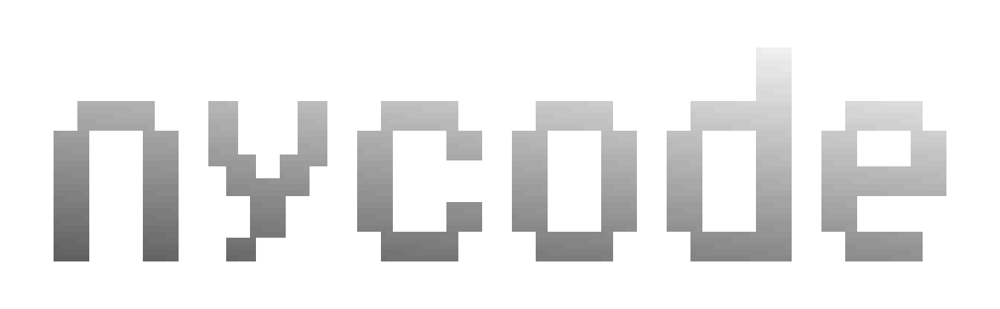

<p align="center">
  
</p>

# Nycode

Nycode is a minimal, extensible agent harness that you can make your own.

Adapt Nycode to your workflows, not the other way around. Customize Nycode with [extensions](packages/coding-agent/docs/extensions.md), [skills](packages/coding-agent/docs/skills.md), [prompt templates](packages/coding-agent/docs/prompt-templates.md), and [themes](packages/coding-agent/docs/themes.md). Bundle them as [Nycode packages](packages/coding-agent/docs/packages.md) and share via npm or git.

Nycode ships with powerful defaults but skips features like sub-agents and plan mode. Ask Nycode to build what you want, or install a package that does it your way.

Use Nycode [interactively](packages/coding-agent/docs/usage.md), automate it in [print or JSON mode](packages/coding-agent/docs/cli.md), control it over [RPC](packages/coding-agent/docs/rpc.md), or build apps with the [Nycode TypeScript SDK](packages/coding-agent/docs/sdk.md). See [OpenClaw](https://github.com/OpenClaw/OpenClaw) for a real-world integration.

## Getting started

Nycode is distributed as source from the public repository. Build it and run the CLI:

```bash
git clone https://github.com/marcioazam/nycode.git
cd nycode
npm ci --ignore-scripts
npm run build
node packages/coding-agent/dist/bundle/cli.js
```

To run it from sources without building, use `./nycode-test.sh` from the repository root. Nycode requires Node.js 22.19 or newer. A normal installation does not need dependency lifecycle scripts, so `--ignore-scripts` is safe.

Start Nycode in the directory where you want it to work (replace `node packages/coding-agent/dist/bundle/cli.js` with `nycode` if you put the binary on your `PATH`, for example with `npm link` in `packages/coding-agent`):

```bash
cd /path/to/project
node /path/to/nycode/packages/coding-agent/dist/bundle/cli.js
```

For a built-in AI provider, run `/login` inside Nycode to connect a subscription or API key. Then give Nycode a task.

See the [documentation](packages/coding-agent/docs/) for full setup and usage instructions.

## Run with Nix

```bash
nix run github:marcioazam/nycode/stable
```

`stable` points at the latest release. Install it with `nix profile add github:marcioazam/nycode/stable` and update with `nix profile upgrade nycode`. Use a release tag such as `github:marcioazam/nycode/v1.0.0` to pin a version, or `github:marcioazam/nycode` for unreleased changes on `main`. Nix builds Nycode from source.

Supports ARM64 and x86-64 on Linux and macOS. Use `nix build .` or `nix run .` to build or run your checkout.

The Nix build is currently broken: it needs an offline source for the bundled model data, which it used to download from a hosted catalog that nycode no longer uses (tracked in `nix/package.nix`).

## Packages

This monorepo contains the Nycode CLI and its supporting libraries.

| Package | Description |
|---------|-------------|
| **[@nycode/chord](packages/chord)** | Object runtime for apps across processes: contracts, documents, a store, links, plugins with hot reload, HTTP, workers, web and terminal clients |
| **[@nycode/telemetry](packages/telemetry)** | Vendor-neutral telemetry contracts, reference adapter, conformance tests, and typed schemas |
| **[@nycode/ai](packages/ai)** | Unified multi-provider LLM API (OpenAI, Anthropic, Google, etc.) |
| **[@nycode/durable](packages/durable)** | Durable conversation, task, and document runtime |
| **[@nycode/agent-core](packages/agent)** | Agent runtime with tool calling and state management |
| **[@nycode/coding-agent](packages/coding-agent)** | Interactive coding agent CLI |
| **[@nycode/tui](packages/tui)** | Terminal UI library with differential rendering |

## Permissions & Containerization

Nycode does not include a built-in permission system for restricting filesystem, process, network, or credential access. By default, it runs with the permissions of the user and process that launched it.

If you need stronger boundaries, containerize or sandbox Nycode. See [packages/coding-agent/docs/containerization.md](packages/coding-agent/docs/containerization.md) for three patterns:

- **Gondolin extension**: keep `nycode` and provider auth on the host while routing built-in tools and `!` commands into a local Linux micro-VM.
- **Plain Docker**: run the whole `nycode` process in a local container for simple isolation.
- **OpenShell**: run the whole `nycode` process in a policy-controlled sandbox.

## Contributing

See [CONTRIBUTING.md](CONTRIBUTING.md) for contribution guidelines and [AGENTS.md](AGENTS.md) for project-specific rules (for both humans and agents).

## Development

```bash
npm install --ignore-scripts  # Install all dependencies without running lifecycle scripts
npm run build         # Refresh model data, then build all packages
npm run build:offline # Rebuild using existing model data without network access
npm run check         # Lint, format, and type check
./test.sh            # Run tests (skips LLM-dependent tests without API keys)
./nycode-test.sh         # Run nycode from sources (can be run from any directory)
```

### Using local packages outside the monorepo

Build every public package into one coherent local artifact set:

```bash
npm run pack:packages -- --out .artifacts/nycode-packages
```

This refreshes model data before building `nycode-ai`. To avoid network access when
model data is already hydrated, pass `--offline-model-data`.

Then configure an external project to consume one package and resolve all of
its Nycode dependencies from the same artifact set. npm is the default:

```bash
node scripts/use-local-packages.mjs \
  --manifest .artifacts/nycode-packages/manifest.json \
  --consumer ../my-project \
  --package @nycode/durable \
  --package @nycode/agent-core
cd ../my-project
npm install --ignore-scripts
```

For a pnpm project, point `--consumer` at the workspace root:

```bash
node scripts/use-local-packages.mjs \
  --manifest .artifacts/nycode-packages/manifest.json \
  --consumer ../my-project \
  --package @nycode/agent-core \
  --package-manager pnpm
cd ../my-project
pnpm install --ignore-scripts
```

Repeat `--package` for each direct dependency. The command updates the
consumer's `package.json` with content-addressed local `file:` references. It
writes transitive overrides to `package.json` for npm or `pnpm-workspace.yaml`
for pnpm. Keep the artifact directory available while installing or updating
the consumer. Re-run both commands after changing Nycode source.

## Building standalone binaries from release source

GitHub releases include a versioned source archive covered by the release's `SHA256SUMS` file. Extract it and run the same build script used for the official standalone binaries:

```bash
VERSION="<release-version>"
tar -xzf "nycode-${VERSION}-source.tar.gz"
cd "nycode-${VERSION}"
./scripts/build-binaries.sh --offline-model-data --platform linux-x64 --out "$PWD/out"
```

The archive includes release model data and native prebuilds. `--offline-model-data` uses that model data without refreshing provider catalogs. The script installs dependencies and builds the executable with its runtime assets; pass `--skip-install` if dependencies are already provided.

## Supply-chain hardening

We treat npm dependency changes as reviewed code changes.

- Direct external dependencies are pinned to exact versions. Internal workspace packages remain version-ranged.
- `.npmrc` sets `save-exact=true` and `min-release-age=2` to avoid same-day dependency releases during npm resolution.
- `package-lock.json` is the dependency ground truth. Pre-commit blocks accidental lockfile commits unless `NYCODE_ALLOW_LOCKFILE_CHANGE=1` is set.
- `npm run check` verifies pinned direct deps, native TypeScript import compatibility, and the generated coding-agent install lock.
- The installer installs from `packages/coding-agent/install-lock/`, generated from the root lockfile, to pin transitive deps. The npm package does not pin transitive deps.
- Local release smoke tests and npm publication use the same tarball packer; npm publishes the validated tarballs rather than repacking workspace directories.
- Local release installs, documented npm installs, and `nycode update --self` use `--ignore-scripts` where supported.
- CI installs with `npm ci --ignore-scripts`, and a scheduled GitHub workflow runs `npm audit --omit=dev` plus `npm audit signatures --omit=dev`.
- Install lock generation has an explicit allowlist for dependency lifecycle scripts; new lifecycle-script deps fail checks until reviewed.

## License

MIT. See [LICENSE](LICENSE) and [NOTICE](NOTICE).
